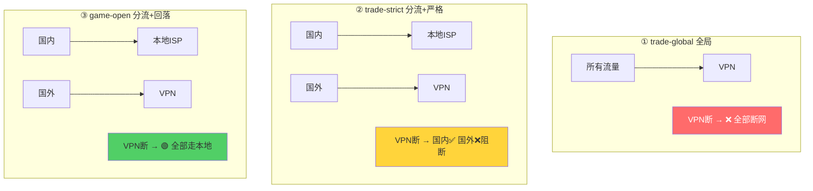

# openvpn-wm — 外贸 + 游戏A 分流平台

> **wm = Wai Mao（外贸）**。一套 OpenVPN 服务端，同时支撑 **3 种账号类型**，配 Web 管理端开户。
> 最后更新：2026-09-03

---

## 🎯 三种方案（一套服务端全搞定）

| 代号 | 名称 | 分流 | **VPN 断线时** | 用途 |
|---|---|---|---|---|
| `trade-global` | **① 全局** | ❌ 全部走 VPN | 🔴 **断网**（fail-close） | 外贸，要求纯净出海环境 |
| `trade-strict` | **② 分流 + 断网不走本地** | ✅ 国内本地 / 国外 VPN | 🔴 **国内通，国外一律阻断** | 外贸，要国内业务不受影响，但绝不允许国外流量裸奔 |
| `game-open` | **③ 分流 + 断网走本地** | ✅ 国内本地 / 国外 VPN | 🟢 **全部回落本地** | 游戏，不能掉线 |

**② 和 ③ 的唯一区别就是断线策略** —— 一个保安全，一个保可用。



---

## 📖 开工必读（按顺序）

| 文件 | 作用 |
|---|---|
| **[REQUIREMENTS.md](REQUIREMENTS.md)** | 🔴 **需求唯一事实来源**。3 种方案精确规格。有分歧以此为准 |
| **[ARCHITECTURE.md](ARCHITECTURE.md)** | 技术架构：profile 引擎 / 三层 DNS 防污染 / 三种 kill-switch |
| **[ROADMAP.md](ROADMAP.md)** | 分期计划 + 3 个会话怎么切 + 需要你提供什么 |
| **[docs/adr/](docs/adr/)** | 已拍板决策 |
| **[handoff/](handoff/)** | 各开发会话的交接说明 |

---

## 🗂️ 目录结构

```
openvpn-wm/
├── REQUIREMENTS.md       🔴 需求唯一事实来源
├── ARCHITECTURE.md       技术架构
├── ROADMAP.md            分期 + 会话切分
├── docs/
│   ├── adr/              决策记录
│   └── *.md              技术笔记（DNS防污染/IPv6/钩子原理/排错）
├── handoff/              会话交接
│   ├── S1-server-core.md      服务端核心   🔥
│   ├── S2-client-killswitch.md 客户端+断线策略 🔥
│   └── S3-web-panel.md        Web 管理端   🔸
│
├── profiles/             🔑 三种方案的声明式定义（S1↔S2 契约）
│   ├── trade-global/     ① 全局
│   ├── trade-strict/     ② 分流+断网不走本地
│   └── game-open/        ③ 分流+断网走本地
│
├── server/               服务端（VPS 上跑）
│   ├── openvpn/          server.conf + ccd 生成
│   ├── dnsmasq/          DNS 分流
│   ├── stubby/           DoT 加密上游（防污染核心）
│   ├── firewall/         iptables + IPv6 DROP
│   ├── scripts/          开户/吊销/更新数据
│   └── systemd/
│
├── client/               客户端
│   ├── macos/            安装器 + pf kill-switch
│   ├── windows/          安装器 + netsh/WFP
│   ├── linux/            安装器 + nftables
│   └── ikuai/            路由器导入说明
│
├── web-panel/            管理端（FastAPI + Vue3）
├── deploy/               一键部署
├── shared/               IP 段 + 域名数据
├── scripts/              工具（拉数据 / 自检）
├── tests/                验证脚本
└── legacy/               ⚠️ 历史代码，仅供参考
    ├── 方案B旧代码/       S1 重构的参考源
    ├── 方案A已废弃/       ❌ 已排除，只留档查历史坑
    ├── PLAN.md           ⚠️ 过时
    └── HANDOFF.md        ⚠️ 过时
```

---

## 🚀 快速开始

```bash
# 1) 自检环境
bash scripts/verify-project.sh

# 2) 数据文件（若缺失）
bash scripts/fetch-data.sh

# 3) 开发：开新会话，让它读对应交接文档
#    先 S1（服务端核心）→ 同时 S2（客户端）→ 再 S3（面板）
```

---

## 🔗 与 openvpn-game 的关系

| | **openvpn-wm**（本项目） | openvpn-game |
|---|---|---|
| 内容 | 外贸① ② + 游戏③ | 游戏加速器产品 |
| 出海策略 | 全放行（正常 VPN） | **仅游戏白名单出海，封海外媒体** |
| 客户端 | 通用 `.ovpn` | 自研 Windows GUI |
| 收款 | ❌ 无 | ✅ 扫码收款 |
| 服务器 | 主线 VPS | **独立 VPS** |
| 关系 | 🔒 **完全独立，不共享代码/服务器/数据库** | |

> 两个项目**互不依赖**，可以分别开发、分别部署。共享的只有"IP 段/域名数据"这类公开数据（各存一份副本）。

---

## ✅ 核心特性

| 特性 | 实现 |
|---|---|
| 国内直连 | 服务端 CCD push 精简直连表（默认 1300 条 CN 大网段，≈98.7%），客户端走本地 ISP |
| 国外走 VPN | `redirect-gateway` |
| **DNS 防污染** | 三层：客户端强制用 VPN DNS → 服务端 dnsmasq 分流 → **stubby DoT 加密上游 + iptables 封死明文 53 出站** |
| **断线策略** | 三种可选：`close-all` / `close-foreign` / `open`（见上表） |
| IPv6 | 彻底封死（服务端 ip6tables + push block-ipv6） |
| 多用户 | 一证书一用户，CCD 区分 profile，可吊销/续期/限速 |
| 商业化 | Web 面板开户、流量统计、到期管理、审计日志 |

---

## 🔒 安全提示

- 私钥 / 证书 / `.ovpn` 全部不入 git（见 `.gitignore`）
- 旧服务器 `YOUR_OLD_SERVER_IP` 密码已泄漏 → **弃用，新机 SSH key only**
- Web 面板必须 HTTPS + 2FA
